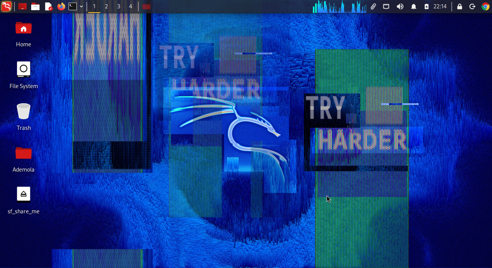
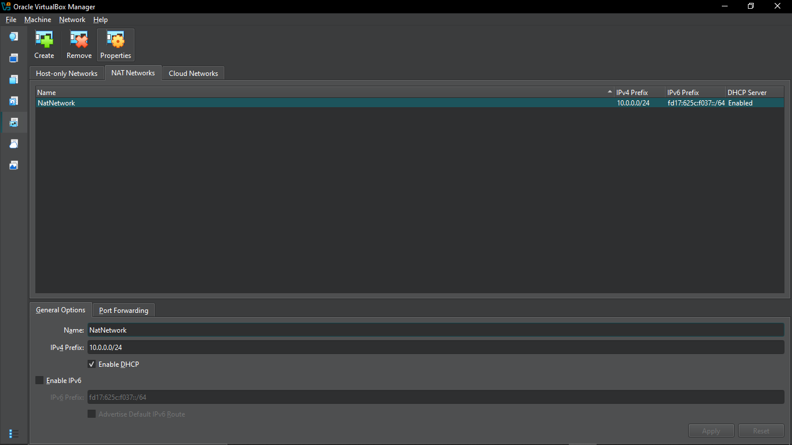
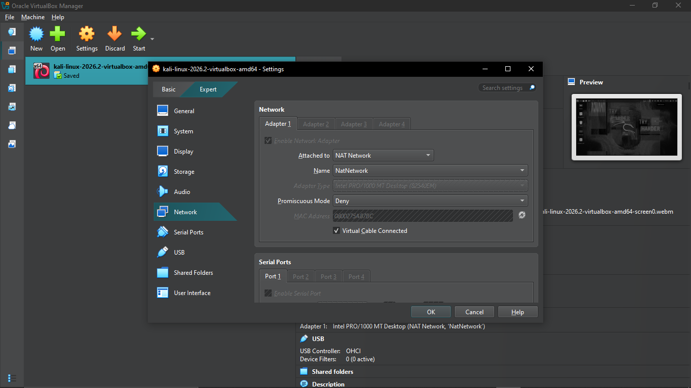
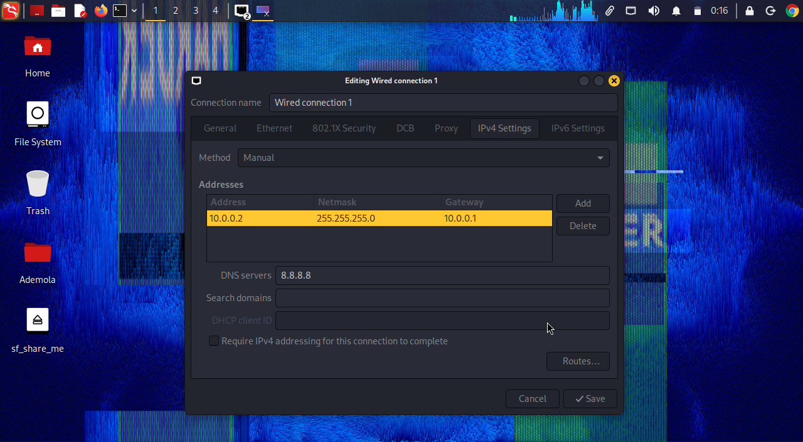
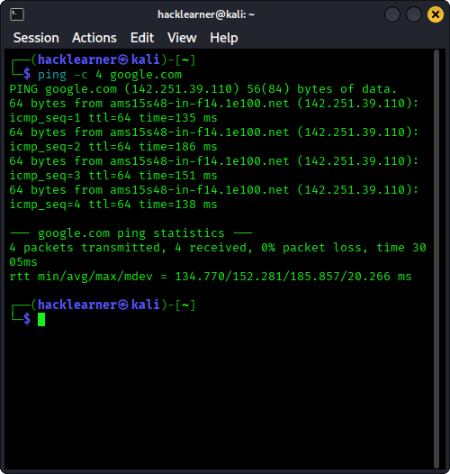
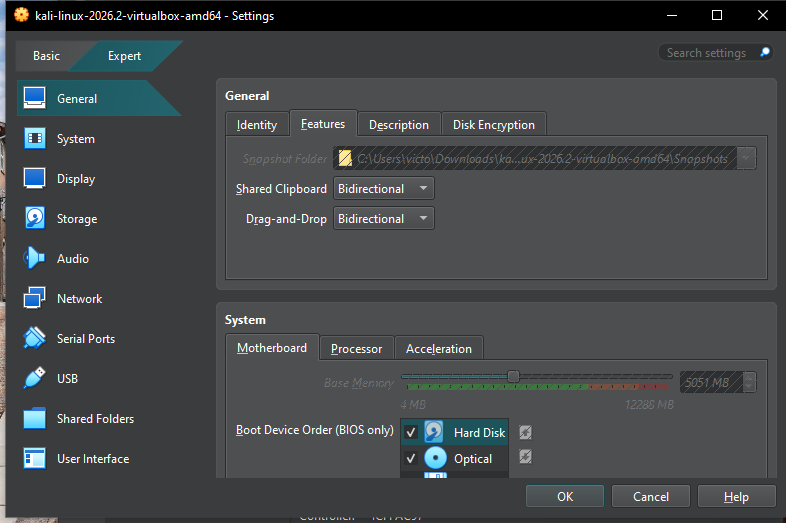
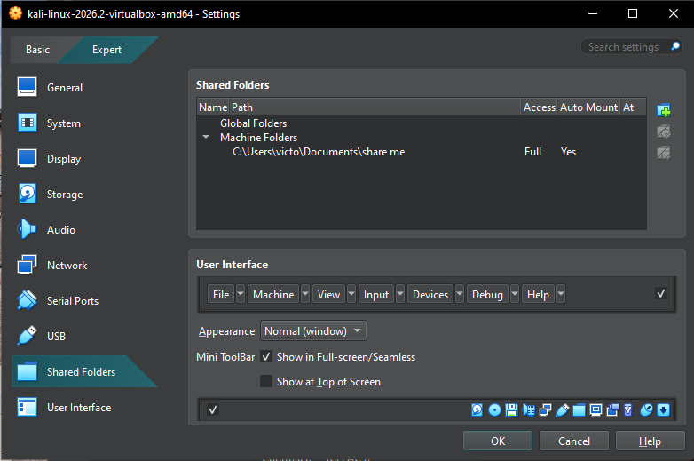
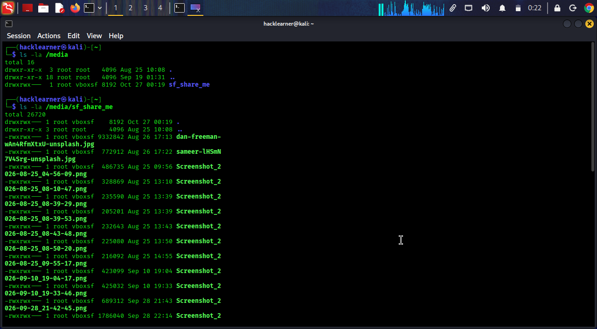
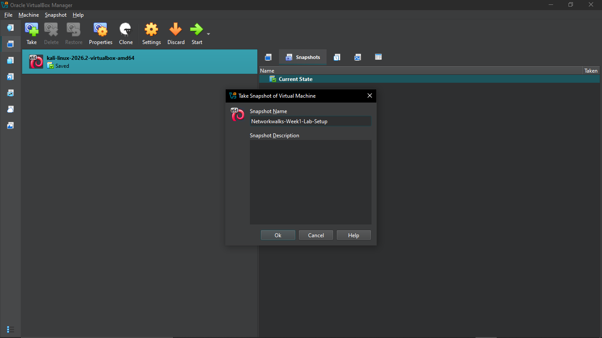

Cybersecurity & Pentesting Lab Setup | Networkwalks Internship

Project Overview

This project documents my Week 1, Project Module 1 assignment for the Networkwalks Cybersecurity Program, Batch B084.
The aim of this project is to set up and configure a virtual environment for cybersecurity learning and ethical hacking practice using Oracle VirtualBox and Kali Linux.

I worked with my existing Kali Linux virtual machine and focused on configuring the environment to meet the lab requirements. This included setting up a private NAT Network, configuring the required IP address, enabling communication between my host and virtual machine where needed, testing internet connectivity, and preparing a snapshot for recovery.
This project also gave me the opportunity to understand how virtual machines communicate through a virtual network and why proper network configuration is important when building a cybersecurity lab.
Project Objectives

The main objectives of this project were to:

Set up and configure a cybersecurity testing environment using VirtualBox.

Configure a NAT Network with the subnet 10.0.0.0/24.

Connect Kali Linux to the configured NAT Network.

Configure the Kali Linux IP address to 10.0.0.2/24.

Enable clipboard sharing and drag-and-drop between the host and guest where supported.

Configure a shared Downloads folder between Windows and Kali Linux.

Test internet connectivity and DNS resolution.

Create a virtual machine snapshot to preserve the lab configuration.

Document the setup process with screenshots and technical notes.

System Specifications
The following are the specifications of my host system.
Component	Specification
Laptop:	Toshiba Satellite E55-A5114
Host Operating System: Windows 10 Home 64-bit
RAM: 12 GB
Storage	: 256 GB SATA SSD
Virtualization Platform:   Oracle VirtualBox
Virtual Machine:  Kali Linux
Network Type:  NAT Network

Tools and Technologies
1. Oracle VirtualBox
VirtualBox provides the virtualization platform used to run Kali Linux as a guest operating system on my Windows laptop.
It allows me to configure virtual hardware, networking, shared folders, and snapshots without needing a separate physical computer for the lab.
2. Kali Linux
Kali Linux is the operating system used as the cybersecurity testing machine in this project.
It provides a Linux environment for learning cybersecurity concepts and carrying out authorized security testing in controlled lab environments.
3. 7-Zip
7-Zip is used to extract compressed virtual machine files when required. It is included in the lab instructions for preparing the Kali Linux virtual machine.
4. VirtualBox NAT Network
The NAT Network provides a virtual network through which connected virtual machines can communicate while accessing external networks through network address translation.
For this lab, the required subnet is 10.0.0.0/24.

Lab Network Configuration
The network was designed according to the Networkwalks Week 1 lab requirements.
Setting	Required Configuration
Network type	NAT Network
Network name	NatNetwork
IPv4 network prefix	10.0.0.0/24
Kali Linux IP address	10.0.0.2/24
Default gateway	10.0.0.1
DNS server	8.8.8.8

Understanding the IP Address
One important detail I learned from this configuration is the difference between the network address and the address assigned to a machine.
10.0.0.0/24 identifies the network.
10.0.0.2/24 is the required address for the Kali Linux virtual machine.
10.0.0.1 is the configured default gateway in the lab example.

Implementation and Configuration
Step 1: Check the Virtualization Environment
I started by checking the existing VirtualBox installation and Kali Linux virtual machine.
Since Kali Linux was already installed on my system, I used the existing VM as the starting point rather than removing it and reinstalling the operating system unnecessarily.
The existing installation was then used to carry out the required lab configuration.

Step 2: Configure the NAT Network
The next task was to configure the NAT Network in VirtualBox.
The required network prefix was set to:
10.0.0.0/24
The network configuration was checked against the Networkwalks lab example. The DHCP setting should also be documented as it appears in the actual VirtualBox configuration.
This network provides the foundation for connecting Kali Linux and any additional lab virtual machines.

Step 3: Configure the Kali Linux Network Adapter
The Kali Linux virtual machine was configured to use the custom NAT Network rather than an unrelated network mode.
The adapter configuration was checked to ensure that:
The network adapter was enabled.
The attachment type was NAT Network.
The selected network was NatNetwork.

Step 4: Configure the Kali Linux IP Address
The required IPv4 address for Kali Linux is:
10.0.0.2/24
The manual IPv4 configuration uses the following values from the lab example:
Address: 10.0.0.2
Netmask: 24
Gateway: 10.0.0.1
DNS server: 8.8.8.8
The settings were to be applied through Kali Linux's network connection configuration and checked after reconnecting the interface.

Step 5: Test Network Connectivity and DNS Resolution
After configuring the network, connectivity was checked from the Kali Linux terminal.
The following command was used to perform the test.
Test connectivity and DNS resolution:
ping -c 4 google.com

Step 6: Configure Clipboard and Drag-and-Drop
The VirtualBox settings were configured to allow clipboard sharing and drag-and-drop between the host and guest operating systems.
The intended settings were:
Shared Clipboard: Bidirectional
Drag'n'Drop: Bidirectional

Step 7: Configure the Shared Downloads Folder
The lab requires a shared folder from the Windows host to the Kali Linux virtual machine.
The intended configuration uses the host's actual Downloads folder, with the VirtualBox shared-folder name set to sf_share_me.
Automatic mounting and permanent sharing was be enabled.
After starting Kali Linux, the mount point was checked with:
ls -la /media
If the shared folder appears as sf_share_me its contents can be inspected with:
ls -la /media/sf_share_me
This configuration makes it possible to exchange files between the host and guest without manually downloading the same files twice.

Step 8: Create a Virtual Machine Snapshot

The final Phase 1 task is to create a snapshot of the configured Kali Linux virtual machine.
The snapshot preserves a recoverable state of the VM and is useful before making changes during future cybersecurity exercises.

snapshot name:

Networkwalks-Week1-Lab-Setup

The snapshot should be taken after the required configuration has been completed and verified.

Challenges and Troubleshooting
One of the important parts of setting up a virtual lab is ensuring that the network configuration is consistent across VirtualBox and the guest operating system.
The following are the main areas I checked or identified for troubleshooting during the setup.
1. Understanding the Network Address
It is easy to confuse the network address with the IP address assigned to a virtual machine.
The lab uses 10.0.0.0/24 for the NAT Network and 10.0.0.2/24 for Kali Linux.
Understanding this distinction helps prevent incorrect IP configuration.
2. NAT Network and Internet Connectivity
A virtual machine may have an enabled network adapter without having working internet access.
The network attachment, IP address, gateway, and DNS settings must all be checked when troubleshooting connectivity.
3. Shared Folder Access
Enabling a shared folder in VirtualBox does not automatically prove that it is accessible from Kali Linux.
The mount point, Guest Additions, and user permissions may need to be checked.
4. Virtual Machine Recovery
Snapshots provide a useful recovery point when experimenting with network settings or installing additional cybersecurity tools.
A clean and properly named snapshot helps make future lab work easier to manage.
Only include challenges that you actually encountered and the solutions you actually applied. Add your specific error messages and successful fixes here if applicable.
Lessons Learned
This project helped me understand the importance of preparing a working environment before beginning practical cybersecurity exercises.

Some of the key areas covered were:

The role of VirtualBox in running multiple operating systems on one computer.

The difference between a virtual network and an individual machine's IP address.

How a NAT Network connects virtual machines and supports internet access.

How to configure and verify a static IPv4 address.

The difference between IP connectivity and DNS resolution.

How shared folders and clipboard integration support a virtual lab.

Why snapshots are useful for recovering a virtual machine's previous state.

Why screenshots and clear documentation are important when presenting technical work.

The project also reinforced the importance of checking each configuration rather than assuming that a setting works simply because it has been enabled.

Conclusion

This Week 1 project provides a foundation for my cybersecurity learning journey with Networkwalks.
By configuring the virtual machine environment, documenting the network settings, and checking connectivity, I am building a better understanding of the systems and networking concepts required for practical cybersecurity work.

The goal is not just to have Kali Linux running, but to understand how the environment is configured, how to verify that it works, and how to maintain a reliable lab for future exercises.
This documentation will serve as a reference as I continue learning and working on more practical cybersecurity projects.

References

Networkwalks Week 1 Project Module 1: Lab Setup VirtualBox and Kali Linux.

Kali Linux Official Website: https://kali.org/get-kali

Oracle VirtualBox: https://virtualbox.org/wiki/Downloads

7-Zip Official Website: https://7-zip.org/download.html

Project: Week 1 — Cybersecurity & Pentesting Lab Setup

Program: Networkwalks Cybersecurity Internship, Batch B082

Author: Victor Ebubechukwu

Linkedin Post https://lnkd.in/p/exn-h_ZR
